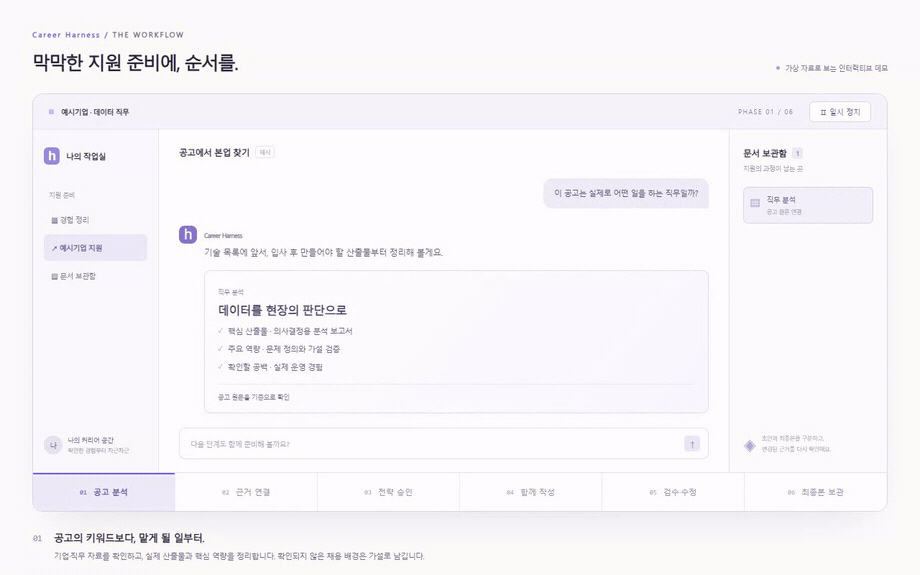
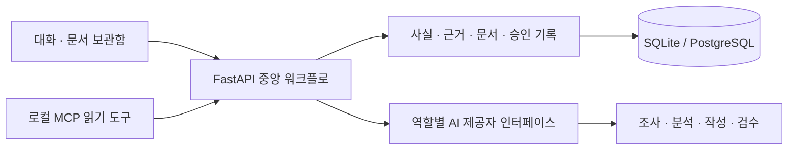

<div align="center">

# Career Harness

### 해낸 일은 정확하게. 지원서는 설득력 있게.

공고를 이해하고, 경험을 근거로 연결하고, 자소서와 이력서를 함께 준비하는 커리어 작업실.

[작업실](https://career-harness-web.vercel.app/workspace) · [서비스 소개 · 가상 데모](https://career-harness.lilacdegu3.chatgpt.site) · [30초 소개 영상](frontend/public/showcase/career-harness-demo.mp4) · [실행 안내](RUN_LOCAL.md) · [설계 문서](docs/00_PRODUCT_SCOPE.md)



*화면은 가상 자료로 만든 제품 흐름 데모입니다. 실제 지원자 자료나 AI 응답을 사용하지 않습니다.*

</div>

## 어떤 서비스인가요?

취업 준비를 하다 보면 같은 일을 반복합니다. 공고를 분석하고, 내 경험을 찾아 연결하고, 자소서를 쓴 뒤, 수치와 기여 범위를 다시 확인합니다. 회사가 달라지면 처음부터 다시 설명하고, 최종 문서가 어디 있는지도 찾아야 합니다.

**Career Harness는 이 과정을 하나의 작업실에 연결합니다.** 대화로 작업을 진행하면서, 오른쪽 보관함에는 직무 분석·지원 전략·문항별 초안·이력서·최종본이 쌓입니다. 각 문서에는 사용한 근거와 버전, 확인 상태가 남습니다.

## 지원 한 건은 이렇게 진행됩니다

| 단계 | 하는 일 | 남는 결과 |
|---|---|---|
| 01 · 공고 분석 | 회사 자료와 공고를 읽고, 실제 맡게 될 일과 핵심 역량을 정리 | 출처가 있는 조사 기록·직무 분석 |
| 02 · 근거 연결 | 내 경험의 사실·수치·기여 범위를 확인하고 직무와 대조 | 직접·인접 근거와 현재 공백 |
| 03 · 전략 승인 | 무엇을 먼저 증명할지 정하고 문항마다 메시지를 배분 | 사용자가 승인한 지원 전략·문항 설계 |
| 04 · 함께 작성 | 같은 근거로 자소서와 레쥬메를 목적에 맞게 작성 | 문항별 초안·구조화된 이력서·버전 |
| 05 · 검수와 수정 | 과장·출처·역할을 점검하고 질문에 답한 뒤 수정 | 검수 기록·답변·수정 이력 |
| 06 · 최종본 보관 | 최종 확인을 거쳐 당시 문서와 근거를 보관 | 변경되지 않는 최종본·면접 준비 자료 |

**최종본 보관과 실제 제출은 별도입니다.** 외부 채용 사이트에 자동으로 지원서를 제출하지 않습니다.

## 이렇게 설계했습니다

- **근거를 확인한 뒤 작성합니다.** 전략·핵심 메시지의 확인 절차를 거쳐 문서를 만듭니다.
- **사실과 표현을 분리합니다.** 과거의 좋은 문장을 참고하더라도 수치와 성과가 새 사실로 등록되지는 않습니다.
- **변경을 추적합니다.** 근거가 바뀌면 관련 문서를 재검토하고, 이미 보관한 제출본은 유지합니다.
- **결정은 사용자가 확인합니다.** 전략 승인·문서 잠금·실제 제출 확인을 별도로 기록합니다.
- **AI 없이도 시작할 수 있습니다.** 직접 작성 모드를 제공하며, AI 사용 시에는 제공자 연결과 사용 한도가 필요합니다.

## 빠르게 실행하기

Windows PowerShell, Python 3.12 이상, Node.js 22 이상이 필요합니다.

```powershell
git clone https://github.com/yoon-chan-hyeok/career-harness.git
cd career-harness
./scripts/start-local.ps1
```

1. `http://127.0.0.1:3000`에서 서비스 소개를 엽니다.
2. **작업실 열기**를 누르거나 `http://127.0.0.1:3000/workspace`로 이동합니다.
3. 실행 화면에 표시된 개인 접속 토큰으로 연결합니다.
4. 경험과 공고를 등록합니다. AI 기능은 **설정 → AI 연결**에서 연결 후 사용할 수 있습니다.

처음 실행하면 의존성을 설치하고 SQLite로 시작합니다. 개인 자료와 키는 직접 등록하며, 저장소에 포함되어 있지 않습니다. [자세한 실행·종료 방법](RUN_LOCAL.md)

## 구조



Next.js / TypeScript · FastAPI / Pydantic · SQLAlchemy / Alembic · PostgreSQL / pgvector · GitHub Actions

역할별 작성·검수 함수와 중앙 상태 관리로 구성합니다. MCP는 코어를 이용하는 별도 접근 도구이며, 모든 기능이 원격 MCP로 공개된 상태는 아닙니다.

## 현재 상태

**가입 없이 사용하는 공개 무료 체험을 운영합니다.** [작업실](https://career-harness-web.vercel.app/workspace)에서 방문자별 연결을 만들고 안내에 동의한 뒤 경험과 공고를 등록할 수 있습니다. Supabase DB와 실제 Groq 작성·저장·한국어 PDF를 연결·검증했습니다. 별도의 소개 데모와 영상은 가상 자료를 사용합니다.

- 구현·로컬 검증: 회사 조사, 경험 연결, 사용자 승인, 자소서·이력서, 검수 답변, 최종 확인, 보관·면접 연결.
- 최종 CI 기준(2026-10-15): Python757개, 별도 실제 PostgreSQL9개, 프런트엔드28개와 타입·lint·마이그레이션·개인정보·production build 통과.
- 실제 Groq를 이용한 합성 자소서·레쥬메 생성·저장·한국어 PDF를 확인했습니다. 프로젝트별 표현 제한과 문서 간 충돌·반복 검사를 연결했습니다.
- 체험 연결은24시간·현재 브라우저 탭에서 유지됩니다. 탭 종료·로그아웃·만료 뒤 복구할 수 없으니 필요한 문서는 내려받아 보관하세요. 개인/서비스 전체 무료 한도와 생성·저장량 상한이 적용됩니다.
- 남은 범위: 원문 규칙 전체 실제 인수, 사용자 요청으로 미룬 이메일 인증·발송, 운영 백업 복구·장기 용량 점검. Jev는 미연결입니다.
- 비용·성능 개선 수치와 합격 효과는 주장하지 않습니다. 비교 실험은 현재 범위에서 제외했습니다.

[자동 검사](https://github.com/yoon-chan-hyeok/career-harness/actions) · [구현 상태](IMPLEMENTATION_STATUS.json) · [공개 운영 준비](docs/PUBLIC_SERVICE_SETUP.md)

## 더 읽기

- [서비스 범위](docs/00_PRODUCT_SCOPE.md) · [상태 전이와 변경 추적](docs/05A_STATE_MACHINE_SPEC.md)
- [회사 조사와 승인 표현 재사용](docs/RESEARCH_AND_EXPRESSION_PROGRESS_2026_10_10.md)
- [제출 전 확인과 남은 작업](docs/FINAL_REVIEW_PROGRESS_2026_10_10.md)
- [서비스 소개·모션 데모 구현](docs/SERVICE_PRESENTATION_2026_10_11.md)
- [실제 AI·공개 회원가입 연결 순서](docs/OPERATING_CONNECTION_2026_10_11.md)
- [가입 없는 공개 체험과 운영 범위](docs/GUEST_TRIAL_2026_10_14.md)
- [원래 구현 팩 안내 — 보관본](docs/IMPLEMENTATION_PACK_README.md)

개인 원문·실제 지원서·DB·API 키는 Git에서 제외합니다. 데모와 영상에는 가상 자료만 사용합니다.
