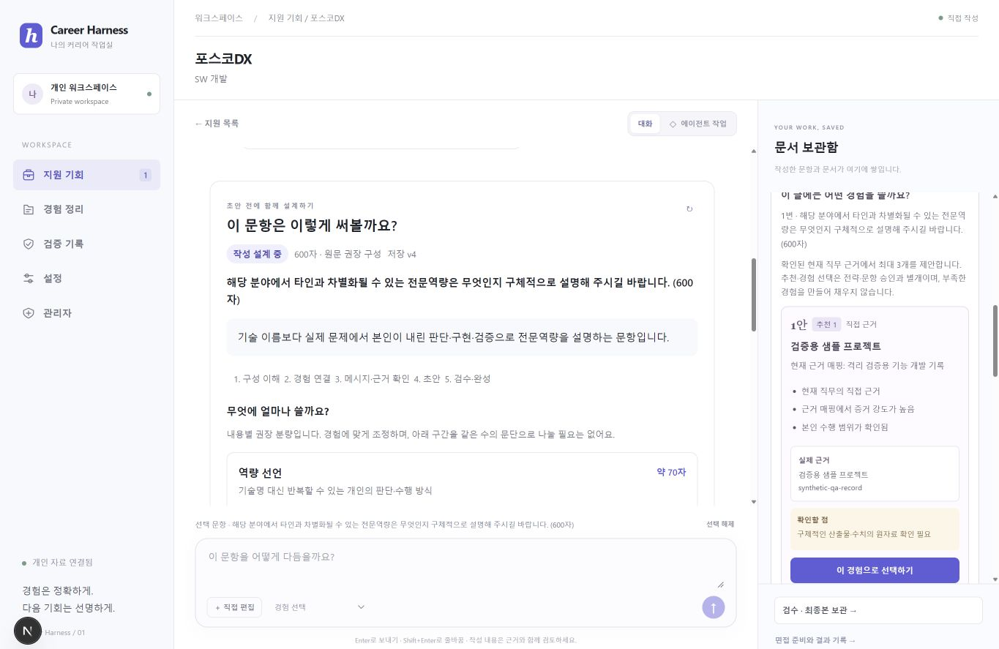
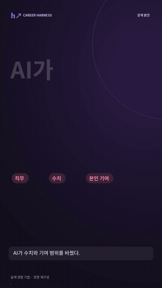

# Career Harness

### 공고를 이해하고, 내 경험으로 지원서를 완성하는 커리어 작업실

경험 정리부터 직무 분석·문항별 설계·자소서·이력서·검수·보관까지. 
대화로 진행하고, 오른쪽 보관함에 근거와 문서를 함께 남깁니다.

**[홈페이지 바로가기 ↗](https://career-harness-web.vercel.app/)** · **[가입 없이 체험하기 ↗](https://career-harness-web.vercel.app/workspace)** · [38초 소개 영상](frontend/public/showcase/career-harness-founder-film.mp4)

*실제 구현 화면에 합성 자료를 넣은 예시입니다.*

## 어떤 서비스인가요?

지원할 때마다 공고를 다시 읽고, 예전에 한 일을 찾고, 문항마다 어떤 경험을 쓸지 정합니다. AI에 작성을 맡겨도 기술 키워드만 보고 직무를 연결하거나, 내 역할과 성과 수치를 바꾸는 일이 생깁니다.

**Career Harness는 이 반복 작업을 지원 한 건의 흐름으로 연결합니다.** 공고에서 실제 맡는 일을 정리하고, 현재 확인된 경험을 근거로 연결합니다. 어떤 메시지를 보여 줄지 정한 뒤 문항의 의도와 권장 구성을 확인하고 작성합니다. 자소서와 이력서, 검수 질문과 수정 이력을 별도로 보관해 다음 지원이나 면접 준비에 이어 갑니다.

취업 준비 중 경험과 문서가 여러 곳에 흩어져 있거나, 초안의 표현을 어디까지 믿어도 될지 확인하고 싶은 사람을 위한 서비스입니다.

## 무엇을 할 수 있나요?

| 기능 | 이용자가 하는 일 | 남는 결과 |
|---|---|---|
| 경험 정리 | 프로젝트 자료와 본인 역할·수치·출처를 등록하고 확인 | 재사용할 경험과 근거 |
| 공고·직무 분석 | 공고와 회사 자료를 가져와 실제 업무와 경험을 대조 | 직무 분석·직접 근거·현재 공백 |
| 지원 전략 | 보여 줄 강점과 문항별 경험을 선택하고 승인 | 지원 전략·문항별 메시지 |
| 초안 전 작성 설계 | 문항 의도·권장 배분·예시를 읽고 경험·강조 방향·메모를 선택 | 화면과 작성 입력에 연결된 문항별 설계 |
| 자소서·이력서 작성 | 확인한 근거로 작성하고 문서별로 수정 | 문항별 초안·구조화된 이력서·버전 |
| 검수·최종본 보관 | 수치·기여·출처·문항 답변을 확인하고 최종본을 잠금 | 검수 기록·보관본·면접 준비 자료 |

**최종본 보관과 실제 제출은 별도입니다.** 채용 사이트에 자동으로 지원서를 제출하지 않습니다.

## 지원 한 건의 흐름

~~~mermaid
flowchart LR
    A["경험·공고 등록"] --> B["직무 분석·근거 연결"]
    B --> C["전략 선택·사용자 승인"]
    C --> D["문항별 설계·주장 검증"]
    D --> E["메시지 승인·자소서 작성"]
    C --> R["이력서 구성·작성"]
    E --> F["검수·수정"]
    R --> F
    F --> G["최종 확인·보관"]
    G --> H["면접 준비"]
~~~

문항별 설계는 자소서 경로이고, 이력서는 같은 현재 사실과 근거를 사용하는 별도 구성·검수 경로입니다. 경험이나 전략이 바뀌면 연결된 문서의 재검토가 필요합니다. 이미 보관한 최종본은 당시 상태로 유지합니다.

승인과 근거 검증은 어떻게 연결되나요?

전략 승인 뒤 문항별 의도·권장 배분·예시·경험·메모를 준비합니다. 이어서 핵심 메시지와 주장을 설계하고, Evidence Test가 선택한 원자료로 주장을 검증합니다. 사용자가 메시지를 승인해야 초안으로 진행할 수 있습니다. 검수에서 질문이나 수정이 생기면 해당 문서를 고친 뒤 다시 확인합니다. AI가 사용자의 승인이나 실제 제출 완료 확인을 대신하지 않습니다.

## 반복하던 판단을 어떻게 도와주나요?

| 고민 | 서비스에서 적용한 판단 |
|---|---|
| “RAG를 써봤으니 이 직무도 맞을까?” | 키워드와 함께 실제 산출물·핵심 업무·직접 경험·부족한 역량을 봅니다. |
| “이 문항에 어떤 경험을 얼마나 쓸까?” | 문항 의도와 권장 구성을 먼저 보고, 보여 줄 판단과 본인 행동을 배분합니다. |
| “예시처럼 쓰면 내 성과도 그렇게 되는 걸까?” | 표현 참고와 사실을 분리합니다. 예시의 프로젝트·기관·수치를 내 경력으로 가져오지 않습니다. |
| “팀에서 한 일을 내가 다 했다고 써도 될까?” | 본인 기여와 주장에 현재 근거를 연결하고, 부족하면 질문하거나 범위를 좁힙니다. |
| “내 역할을 정정했는데 초안은 그대로일까?” | 연결된 결과를 재검토 상태로 바꾸고 근거·메시지를 다시 확인합니다. |

현재 원문 가이드는 특정 회사·직무·문항·글자 제한이 일치하는 1개입니다. 다른 문항은 7종 유형에 따른 **제안 구성**을 제공합니다. 예를 들어 600자 문항의 70/120/280/130자 배분은 등록된 가이드의 권장 예시이며 모든 문항의 고정 공식은 아닙니다.

## 38초로 보는 실제 제작 사례

**[전체 영상 재생 ↗](frontend/public/showcase/career-harness-founder-film.mp4)** · [자막 SRT](frontend/public/showcase/career-harness-founder-film.srt) · [사례·장면 설명](docs/FOUNDER_CASE_FILM_2026_10_20.md) · [기존 40초 기능 소개](frontend/public/showcase/career-harness-reel.mp4)

1080×1920 · 9:16 · 60fps · 한국어 자막 · 직접 합성한 144 BPM 비트와 효과음. 
제작자가 겪은 직무 추천 오판과 경험 범위 변경 문제, 실제 연구 경험의 메시지를 재구성했습니다. 원래 모델 응답이나 개인 지원서 원문을 공개하는 녹화는 아니며, 제품 화면에는 합성 자료를 사용했습니다.

## 바로 사용하기

1. **[홈페이지](https://career-harness-web.vercel.app/)**에서 서비스를 살펴보거나 **[작업실](https://career-harness-web.vercel.app/workspace)**로 바로 이동합니다.
2. 이용 안내를 확인하고 본인의 체험 작업실을 만든 뒤, 경험 자료와 지원할 공고를 등록합니다.
3. 분석과 전략을 확인하고 문항별 설계를 거쳐 작성·검수합니다. 필요한 결과물은 내려받아 보관합니다.

현재는 **가입 없는 공개 무료 체험**입니다. 체험 연결은 24시간·현재 브라우저 탭에서 유지되며, 탭 종료·로그아웃·만료 뒤 복구를 보장하지 않습니다. 개인·서비스 전체 AI 한도와 저장량 상한이 적용됩니다. 전체 자료 JSON 내려받기는 자동 복원 기능이 아닙니다.

## 현재 제공 범위

웹·AI·저장 경로의 운영 인수는 2026-10-17 기록, 코드 전체 검사는 2026-10-20 CI 기준입니다.

- **확인됨:** 공개 웹 → API → DB 저장·조회, 방문자 격리·삭제, 합성 자료의 실제 Groq 자소서·이력서 생성·한국어 PDF, 문항 설계 저장·작성 입력 연결, 사용자 승인·검수·보관 흐름.
- **검증 중:** 개인 전체 자료와 6종 원문 규칙을 넣은 지원서 한 건의 최종 작성 품질. 일부 단계의 입력 한도 문제를 해결해야 합니다.
- **후속 작업:** 운영 DB 복구·장기 운영·원문 가이드 확대. 이메일 인증은 사용자 결정으로 보류했고 Jev는 미연결입니다.
- **검사:** Python 785개·별도 PostgreSQL 9개·프런트엔드 30개 및 lint·타입·마이그레이션·개인정보 검사·production build 통과. 이 검사 수가 합격률이나 실제 지원서 품질을 뜻하지는 않습니다.

[자동 검사](https://github.com/yoon-chan-hyeok/career-harness/actions) · [상세 현황·개선 순서](docs/README_AND_REEL_2026_10_20.md) · [실제 입력 인수 기록](docs/REAL_INPUT_ACCEPTANCE_2026_10_15.md)

## 개발과 설계

Next.js / TypeScript · FastAPI / Pydantic · SQLAlchemy / Alembic · PostgreSQL / pgvector · GitHub Actions

중앙 워크플로가 문서·근거·승인 상태를 관리하고 역할별 프롬프트와 문맥을 호출합니다. MCP는 코어에 접근하는 별도 도구입니다. 모든 기능이 원격 MCP로 공개된 구조는 아닙니다.

내 컴퓨터에서 실행하기

Windows PowerShell, Python 3.12 이상, Node.js 22 이상이 필요합니다.

~~~powershell
git clone https://github.com/yoon-chan-hyeok/career-harness.git
cd career-harness
./scripts/start-local.ps1
~~~

실행 화면에 표시된 개인 토큰으로 http://127.0.0.1:3000/workspace 에 연결합니다. 처음에는 의존성을 설치하고 SQLite로 시작합니다. 직접 작성 모드와 설정의 AI 연결을 사용할 수 있습니다. 개인 자료와 API 키는 저장소에 포함되지 않습니다. [실행·종료 안내](RUN_LOCAL.md)

[서비스 범위](docs/00_PRODUCT_SCOPE.md) · [상태 전이](docs/05A_STATE_MACHINE_SPEC.md) · [문항별 작성 설계](docs/WRITING_PLAN_2026_10_17.md) · [공개 체험 안내](docs/GUEST_TRIAL_2026_10_14.md) · [개인정보·운영 준비](docs/PUBLIC_SERVICE_SETUP.md)

개인 원문·지원서·DB·API 키는 Git에서 제외합니다. 합격 효과·시간 단축률·비용 절감률을 측정 성과로 주장하지 않습니다.
