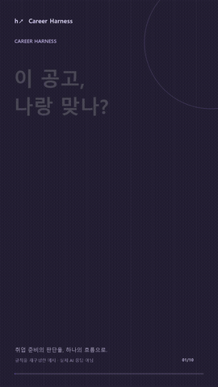
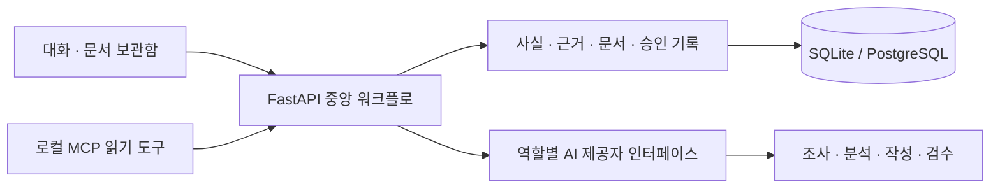

<div align="center">

# Career Harness

### 해낸 일은 정확하게. 지원서는 설득력 있게.

공고를 이해하고, 경험을 근거로 연결하고, 자소서와 이력서를 함께 준비하는 커리어 작업실.

[공개 체험](https://career-harness-web.vercel.app/workspace) · [40초 세로 영상](frontend/public/showcase/career-harness-reel.mp4) · [실행 안내](RUN_LOCAL.md) · [현황·개선 순서](docs/README_AND_REEL_2026_10_20.md)

<a href="frontend/public/showcase/career-harness-reel.mp4"></a>

**40초 · 9:16 · 1080×1920 · 한국어 자막 · 직접 합성한 비트**

[전체 영상 MP4](frontend/public/showcase/career-harness-reel.mp4) · [자막 SRT](frontend/public/showcase/career-harness-reel.srt) · [기존 6단계 화면 데모](frontend/public/showcase/career-harness-demo.mp4)

*구현된 규칙을 가상 사례로 재구성한 모션그래픽입니다. 개인 지원서 원문·실제 AI 응답·합격 성과를 사용하지 않습니다.*

</div>

## 어떤 서비스인가요?

취업 준비를 하다 보면 같은 일을 반복합니다. 공고를 분석하고, 내 경험을 찾아 연결하고, 자소서를 쓴 뒤, 수치와 기여 범위를 다시 확인합니다. 회사가 달라지면 처음부터 다시 설명하고, 최종 문서가 어디 있는지도 찾아야 합니다.

**Career Harness는 이 과정을 하나의 작업실에 연결합니다.** 대화로 작업을 진행하면서, 오른쪽 보관함에는 직무 분석·지원 전략·문항별 초안·이력서·최종본이 쌓입니다. 각 문서에는 사용한 근거와 버전, 확인 상태가 남습니다.

## 어떤 암묵지를 절차로 만들었나요?

아래는 실제 구현 원칙을 보여 주는 가상 사례입니다. 특정 기업의 최신 공고나 지원자의 실적을 뜻하지 않습니다.

| 반복하던 판단 | 구체적인 예시 | 서비스가 남기는 것 |
|---|---|---|
| 키워드보다 본업을 본다 | 같은 RAG여도 API·배포를 맡는 개발과 가설·보고서를 만드는 분석은 다르다 | 실제 산출물·주요 역량·직접 근거·공백 |
| 할 수 있는 말의 범위를 정한다 | 평가 기준을 설계한 경험으로 측정하지 않은 운영 비용 절감을 주장하지 않는다 | 원자료·수치 조건·본인 역할·표현 제한 |
| 문항마다 보여 줄 판단을 나눈다 | 지원동기는 선택 기준, 전문역량은 검증, 협업은 조율 행동을 중심으로 설계한다 | 승인한 전략·문항별 메시지·경험 배분 |
| 쓰기 전에 분량과 역할을 이해한다 | 600자 전문역량 예시의 70/120/280/130자 배분을 보고 경험과 메모를 고른다 | 화면과 실제 작성 입력에 함께 연결된 작성 설계 |
| 좋은 표현과 사실을 구분한다 | 예시의 전개는 참고하되 예시의 프로젝트·기관·성과를 내 사실로 등록하지 않는다 | 사실 저장과 표현 참고의 분리 |
| 정정하면 관련 문서도 다시 본다 | “이 기능은 내가 맡지 않았다”를 반영하면 관련 초안은 재검토하고 보관본은 유지한다 | 의존 관계·재검토 상태·당시 버전 보관 |

600자 배분은 등록된 특정 원문 가이드의 **권장 구성**입니다. 회사·직무·문항·제한이 모두 맞을 때만 적용합니다. 모든 문항에 같은 배분을 강제하지 않습니다.

## 지원 한 건은 이렇게 진행됩니다

~~~mermaid
flowchart TD
    A["경험 자료와 공고 등록"] --> B["회사·직무 조사: 실제 업무와 출처"]
    B --> C["경험 연결: 직접 근거 · 인접 근거 · 공백"]
    C --> D["지원 전략과 문항별 경험 배분"]
    D --> E{"사용자 전략 승인"}
    E -- "보완" --> D
    E -- "승인" --> F["문항별 작성 설계: 의도 · 분량 · 예시 · 경험 · 메모"]
    F --> G["메시지와 주장 설계"]
    G --> H["Evidence Test: 원문으로 주장 검증"]
    H --> I{"사용자 메시지 승인"}
    I -- "근거 보완" --> C
    I -- "승인" --> J["자소서 초안"]
    E -- "승인 후 · 이력서 흐름" --> R["이력서 구성 · 작성"]
    J --> K["사실 검수 · 채용 관점 검수"]
    R --> K
    K -- "질문 · 수정" --> U["해당 자소서·이력서 수정"]
    U --> K
    K --> L["최종 확인 · 버전 잠금 · 최종본 보관"]
    L --> M["면접 준비 연결"]
    L --> N["실제 제출은 별도 직접 확인"]
~~~

이력서는 같은 현재 사실과 근거를 사용하며 별도의 구성·검수·잠금 단계를 거칩니다. 문항별 작성 설계는 자소서 경로입니다. 경험·전략·문항이 바뀌면 연결된 결과를 재검토하고, 이미 보관한 최종본은 당시 상태로 유지합니다.

| 단계 | 하는 일 | 남는 결과 |
|---|---|---|
| 01 · 공고 분석 | 회사 자료와 공고를 읽고, 실제 맡게 될 일과 핵심 역량을 정리 | 출처가 있는 조사 기록·직무 분석 |
| 02 · 근거 연결 | 내 경험의 사실·수치·기여 범위를 확인하고 직무와 대조 | 직접·인접 근거와 현재 공백 |
| 03 · 전략 승인 | 무엇을 먼저 증명할지 정하고 문항마다 메시지를 배분 | 사용자가 승인한 지원 전략·문항 설계 |
| 04 · 함께 작성 | 문항 의도·권장 분량·예시를 확인하고 내 경험·메모로 설계한 뒤 작성 | 문항별 작성 설계·초안·구조화된 이력서·버전 |
| 05 · 검수와 수정 | 과장·출처·역할을 점검하고 질문에 답한 뒤 수정 | 검수 기록·답변·수정 이력 |
| 06 · 최종본 보관 | 최종 확인을 거쳐 당시 문서와 근거를 보관 | 변경되지 않는 최종본·면접 준비 자료 |

**최종본 보관과 실제 제출은 별도입니다.** 외부 채용 사이트에 자동으로 지원서를 제출하지 않습니다.

## 이렇게 설계했습니다

- **근거를 확인한 뒤 작성합니다.** 전략·핵심 메시지의 확인 절차를 거쳐 문서를 만듭니다.
- **초안 전에 구성을 이해합니다.** 각 문항의 글자 배분·참고 예시·경험·메모를 보고 준비하며, 같은 가이드를 실제 작성 입력에 연결합니다. 현재 원문 가이드는 1개이며 다른 문항은 7종 유형에 따른 제안 구성입니다.
- **사실과 표현을 분리합니다.** 과거의 좋은 문장을 참고하더라도 수치와 성과가 새 사실로 등록되지는 않습니다.
- **변경을 추적합니다.** 근거가 바뀌면 관련 문서를 재검토하고, 이미 보관한 제출본은 유지합니다.
- **결정은 사용자가 확인합니다.** 전략 승인·문서 잠금·실제 제출 확인을 별도로 기록합니다.
- **AI 없이도 시작할 수 있습니다.** 직접 작성 모드를 제공하며, AI 사용 시에는 제공자 연결과 사용 한도가 필요합니다.

## 빠르게 실행하기

Windows PowerShell, Python 3.12 이상, Node.js 22 이상이 필요합니다.

```powershell
git clone https://github.com/yoon-chan-hyeok/career-harness.git
cd career-harness
./scripts/start-local.ps1
```

1. `http://127.0.0.1:3000`에서 서비스 소개를 엽니다.
2. **작업실 열기**를 누르거나 `http://127.0.0.1:3000/workspace`로 이동합니다.
3. 실행 화면에 표시된 개인 접속 토큰으로 연결합니다.
4. 경험과 공고를 등록합니다. AI 기능은 **설정 → AI 연결**에서 연결 후 사용할 수 있습니다.

처음 실행하면 의존성을 설치하고 SQLite로 시작합니다. 개인 자료와 키는 직접 등록하며, 저장소에 포함되어 있지 않습니다. [자세한 실행·종료 방법](RUN_LOCAL.md)

## 구조



Next.js / TypeScript · FastAPI / Pydantic · SQLAlchemy / Alembic · PostgreSQL / pgvector · GitHub Actions

역할별 작성·검수 함수와 중앙 상태 관리로 구성합니다. MCP는 코어를 이용하는 별도 접근 도구이며, 모든 기능이 원격 MCP로 공개된 상태는 아닙니다.

## 현재 상태

**가입 없이 사용하는 공개 무료 체험을 운영합니다.** [작업실](https://career-harness-web.vercel.app/workspace)에서 방문자별 연결을 만들고 안내에 동의한 뒤 경험과 공고를 등록할 수 있습니다. Supabase DB와 실제 Groq 작성·저장·한국어 PDF를 연결·검증했습니다. 별도의 소개 데모와 영상은 가상 자료를 사용합니다.

아래 상태는 **2026-10-17 운영 기록**을 기준으로 합니다. 이번 README·영상 작업은 새로운 AI 품질 검증을 대신하지 않습니다.

| 구분 | 확인된 범위 | 아직 남은 범위 |
|---|---|---|
| 웹·저장·격리 | 공개 HTTPS → API → Supabase 저장·조회, 방문자 간 격리·삭제 | 장기 운영·운영 DB 복구 훈련 |
| 실제 AI | 합성 자소서·이력서 생성·저장·한국어 PDF | 개인 전체 자료·6종 원문 규칙으로 지원서 수준의 전체 생성 인수 |
| 문항별 설계 | 의도·권장 배분·예시·경험·메모와 실제 작성 입력 연결 | 원문 가이드 확대와 의미 유사도 검색 |
| 검수·보관 | 근거 검사·사용자 승인·수정·최종 확인·보관·면접 연결 | 전체 실제 지원 한 건의 최종 품질 검증 |
| 인증·비용 | 방문자별 24시간 체험, 개인·서비스 전체 무료 상한 | 이메일 인증·발송은 사용자 결정으로 보류, Jev 미연결 |

**다음 우선순위: 전체 작성 입력 한도 해결 → 개인 지원서 전체 인수 → 응답 지연 계측 → 운영 복구 확인.** 실제 개인 자료의 전체 작성은 일부 단계에서 입력 한도를 넘어 막혔습니다. [미통과 원인](docs/REAL_INPUT_ACCEPTANCE_2026_10_15.md)과 [개선 작업 목록](docs/README_AND_REEL_2026_10_20.md)을 공개 범위에 맞춰 정리했습니다.

- 구현·로컬 검증: 회사 조사, 경험 연결, 사용자 승인, 자소서·이력서, 검수 답변, 최종 확인, 보관·면접 연결.
- 최종 구현 CI 기준(2026-10-17): Python785개, 별도 실제 PostgreSQL9개, 프런트엔드30개와 타입·lint·마이그레이션·개인정보·production build 통과.
- 실제 Groq를 이용한 합성 자소서·레쥬메 생성·저장·한국어 PDF를 확인했습니다. 프로젝트별 표현 제한과 문서 간 충돌·반복 검사를 연결했습니다.
- 체험 연결은24시간·현재 브라우저 탭에서 유지됩니다. 탭 종료·로그아웃·만료 뒤 복구할 수 없으니 필요한 문서는 내려받아 보관하세요. 개인/서비스 전체 무료 한도와 생성·저장량 상한이 적용됩니다.
- 작업 중 남은 체험 시간과 전체 자료 내려받기 버튼을 제공하며, 첫 작업 안내와 실제 작업실 복귀 경로를 보완했습니다. JSON 내려받기는 자동 복구 기능이 아닙니다.
- 남은 범위: 원문 규칙 전체 실제 인수, 사용자 요청으로 미룬 이메일 인증·발송, 운영 백업 복구·장기 용량 점검. Jev는 미연결입니다.
- 비용·성능 개선 수치와 합격 효과는 주장하지 않습니다. 비교 실험은 현재 범위에서 제외했습니다.

[자동 검사](https://github.com/yoon-chan-hyeok/career-harness/actions) · [구현 상태](IMPLEMENTATION_STATUS.json) · [공개 운영 준비](docs/PUBLIC_SERVICE_SETUP.md)

## 더 읽기

- [현황 대조·개선 순서·숏폼 구성](docs/README_AND_REEL_2026_10_20.md)
- [서비스 범위](docs/00_PRODUCT_SCOPE.md) · [상태 전이와 변경 추적](docs/05A_STATE_MACHINE_SPEC.md)
- [문항별 초안 전 작성 설계](docs/WRITING_PLAN_2026_10_17.md)
- [회사 조사와 승인 표현 재사용](docs/RESEARCH_AND_EXPRESSION_PROGRESS_2026_10_10.md)
- [제출 전 확인과 남은 작업](docs/FINAL_REVIEW_PROGRESS_2026_10_10.md)
- [서비스 소개·모션 데모 구현](docs/SERVICE_PRESENTATION_2026_10_11.md)
- [실제 AI·공개 회원가입 연결 순서](docs/OPERATING_CONNECTION_2026_10_11.md)
- [가입 없는 공개 체험과 운영 범위](docs/GUEST_TRIAL_2026_10_14.md)
- [체험 시간·자료 보관·첫 사용 안내 보완](docs/GUEST_USABILITY_2026_10_15.md)
- [원래 구현 팩 안내 — 보관본](docs/IMPLEMENTATION_PACK_README.md)

개인 원문·실제 지원서·DB·API 키는 Git에서 제외합니다. 데모와 영상에는 가상 자료만 사용합니다.
